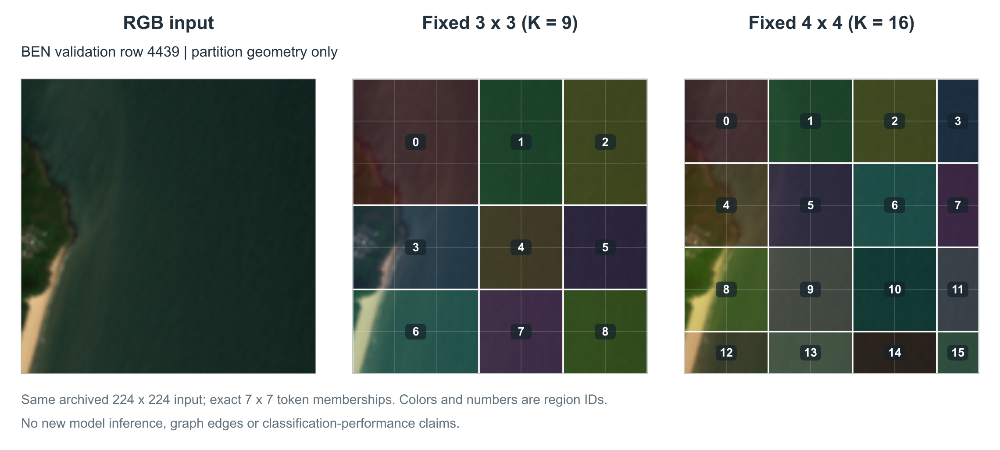

# BEN固定3×3与4×4区域覆盖：第一批同图分析

2026-10-17。按用户确认的顺序，先比较区域分配，再处理三模型对照和实际图边。本批已完成4张归档BEN验证输入的同图覆盖与逐例观察，没有新增训练或模型推理。

2026-10-20后续更新：K9 seed42已回传正式test mAP71.08%，历史K16为72.00%，见[性能对照](ben_grid3_grid4_seed42_20261020.md)。用户重申补跑是为了补齐受训3×3／4×4的可视化；性能对照为辅助证据。本页4张旧验证图仍不包含这次K9/K16预测或图边，真实配对捕获及新图稿尚待完成，见[交付安排](run_ben_grid3_seed42_20261018.md#训练后的可视化交付)。

同日受训模型返回文件已取回、核对并制作[真实图边/预测/汇总权重图稿及分析](ben_gridpair42_visual_analysis_20261020.md)：4例全部保留，4×4有3次标签纠正和1次新增漏判。原图、37个返回文件SHA、8组捕获、76项配对判断均已核对，见[审计](../results/evidence/ben_gridpair42_visual_return_20261020/validation.json)。本页仍只是此前几何阶段的历史记录，不用旧图或旧seed44概率替代新的受训模型结果。

**当前可得结论：4×4提供更小的汇总单元，但这4个案例没有证明它普遍形成更完整的地物区域；可见的收益与代价是局部混合范围变化和结构切分增加。**

## 图稿和来源

- [完整四例PDF](../output/pdf/ben_grid3_grid4_20261017/ben_grid3_grid4_cases.pdf)、[300dpi PNG](../output/pdf/ben_grid3_grid4_20261017/ben_grid3_grid4_300dpi.png)。
- [逐例SVG/PNG与复现说明](../output/pdf/ben_grid3_grid4_20261017/README.md)、[完整分配与来源SHA](../output/pdf/ben_grid3_grid4_20261017/figure_manifest.json)、[像素/成员/导出核对](../output/pdf/ben_grid3_grid4_20261017/export_qa.json)。

图中4张输入为此前seed44反馈诊断已归档的全部4个阈值翻转案例：97389、14680、28450、4439。这是复用现有可访问图像的第一批材料，原来选样具有诊断目的，不能视为19类或整个BEN的代表性抽样。此次没有根据3×3/4×4的观察结果新增筛选，也没有将旧反馈分数当作新网格实验分数。

底图是归档的224×224 RGB显示输入，源PNG字节和底图像素保持，未增强亮度、重新裁剪或生成遥感内容。覆盖图只叠加位置规则产生的区域颜色、边界和ID；颜色不是语义标签，不同K下相同ID也不表示相同地物。4×4成员及token数量与4份历史真实捕获逐一一致；3×3按同一源码的位置规则计算，没有运行受训K9模型。

## 实际分配规则

| 项目 | 3×3 | 4×4 |
|---|---|---|
| 同一输入的token总数 | 49（7×7） | 49（7×7） |
| 区域数 | 9 | 16 |
| 单轴区域宽度（token） | 3／2／2 | 2／2／2／1 |
| 单区域token数 | 4～9 | 1～4 |
| 横纵内部边界，单位为显示像素 | 96、160 | 64、128、192 |

边界基于token成员，不能将224像素简单均匀三等分或四等分。4×4也不是把每个旧3×3区域再切成子区：两套内部边界位置不同。显示格不是Swin token的独立感受野。

4×4右下角区域15只有一个token，这是固定位置规则的结果；区域内加权汇总在该区域没有多个token可选择，不应由此称作训练中的区域塌缩。

## 逐例观察

### a. row97389：线状浅色结构仍跨多个区域

[查看完整对照](../output/pdf/ben_grid3_grid4_20261017/row_97389_grid3_grid4.png)。原图左侧可见细长浅色纹理，其余大部分为深绿色纹理，右侧有颜色较浅的斑块。

- 3×3左列覆盖x=0～96，线状纹理与较宽背景一起归入区域0／3／6。
- 4×4左列缩为x=0～64，并沿纵向分成0／4／8／12；这些汇总单元更小，但浅色线状结构仍跨多个区域。
- 可讨论的是背景混合范围和分组尺度变化，不能认定模型识别了道路，或认为更多区域必然保留了更好的语义整体。图像较暗，细节不足以提供精确地物边界。

### b. row14680：较大的浅绿色斑块也会被进一步切分

[查看完整对照](../output/pdf/ben_grid3_grid4_20261017/row_14680_grid3_grid4.png)。原图上方以连续深色纹理为主，下方偏左及中央可见较浅绿色斑块。

- 3×3在y=160附近分出底行，部分较浅斑块落在底行区域6／7中。
- 4×4增加y=192边界，将下方较浅斑块分到8／9及12／13等更多区域。两种网格的直线都没有沿不规则色调过渡形成内容边界。
- 这是应保留的切分代价观察：更细会增加节点数量，但不自动意味着同类地物被更连贯地聚合。此处没有用人工像素标注判断哪种网格语义质量更高。

### c. row28450：不规则斑块与斜向纹理未形成对应分区

[查看完整对照](../output/pdf/ben_grid3_grid4_20261017/row_28450_grid3_grid4.png)。图中存在深浅交错的不规则斑块、浅色线状纹理和左侧边缘色带。

- 两种网格都使用横纵直线，均穿过部分斑块；3×3的较大区域汇总更多不同纹理。
- 4×4将这些区域拆成更小单元，但浅色斜向结构依然跨越多个区域，没有形成沿结构延展的单一区域。
- 当前属于局部组织变化的中性案例，不能仅由颜色块变多断言混合得到解决，也不从视觉纹理直接修正数据集标签。

### d. row4439：岸带所在区域变窄，但岸水混合仍存在

原图左侧为狭窄浅色岸带和绿色陆地区域，大部分右侧画面为水面。

- 3×3左列宽96像素，区域0／3／6将岸带与较宽水面共同归入一个空间单元。
- 4×4左列宽64像素，区域0／4／8／12对应的覆盖范围更窄，紧邻其右侧已有其他区域。因此，包含岸带的区域可以少覆盖一些水面背景。
- 但4×4仍未沿弯曲岸线划界，左侧区域仍混合陆地、岸带与水面；连续岸带也沿纵向被分成更多组。它同时展示了局部汇总范围缩小和连续结构切分增加，不能作为“4×4完成了语义分割”的证据。

## 与分类、图连接的关系

本批回答的是“9个或16个固定区域会覆盖哪些图像内容”。它没有比较两套受训网络的分类准确率、mAP、注意力或实际图边，也不能解释之前seed42/43/46/47三模型的性能差异。

导师要求的“混合边是否连接语义相关区域”仍需真实模型前向捕获；本图不人工补画特征边。后续三模型图应对齐同一seed、同一阶段和同一批样本，不能把这些历史验证图当作正式test收益案例。

2026-10-17的[既有3×3性能审查](ben_k9_k16_comparability_audit_20261017.md)在当时未找到可复用的BEN K9结果；随后用户授权补跑K9/42，现已收到上述全量测试指标。这一步补上了受训3×3权重的来源，接下来须用两套受训权重对同一批输入捕获真实图边与预测，再将总体/逐类性能作为解释背景。现有4张几何图可作固定首批输入，但旧seed44的图边/分数不能改标成K9/42或K16/42；所有4例保留，无需为可视化再训练。完成此对照后，再处理Swin／固定4×4／软分配三模型图。

## 可用于论文的图注

中文：BigEarthNet-19四张归档验证输入上的固定区域几何对照。每行依次为RGB显示输入、3×3及4×4固定区域覆盖。两种划分将同一7×7 token网格分别映射为9和16个区域；颜色和数字仅表示区域ID。底图源像素保持，区域边界按实际位置分配规则绘制。案例来自历史诊断子集，本图未运行受训3×3模型，不包含新预测或图连接，也不估计总体分类或语义区域质量的改善。

English: Fixed partition geometry on four archived validation inputs from BigEarthNet-19. Each row shows the RGB display input and the fixed 3 x 3 and 4 x 4 partitions, which map the same 7 x 7 token lattice to nine and sixteen regions. Colors and numbers identify region IDs, not semantic classes. Native input pixels are retained and boundaries follow the exact position-based assignments. These historical diagnostic cases provide qualitative geometric observations; the figure contains no new model predictions or graph connectivity and does not estimate classification or semantic-quality improvements.
