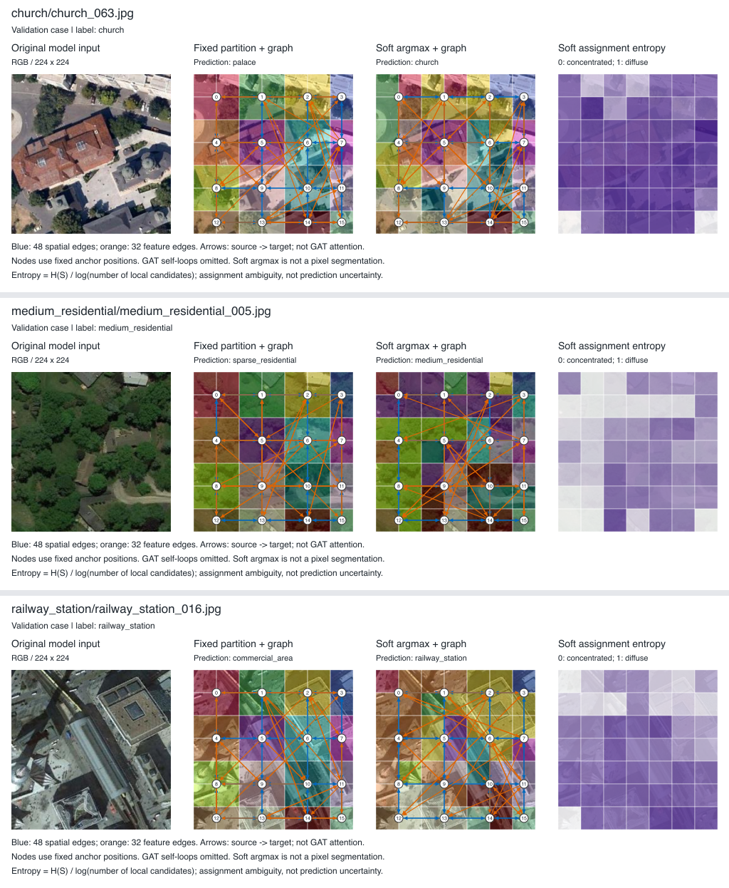
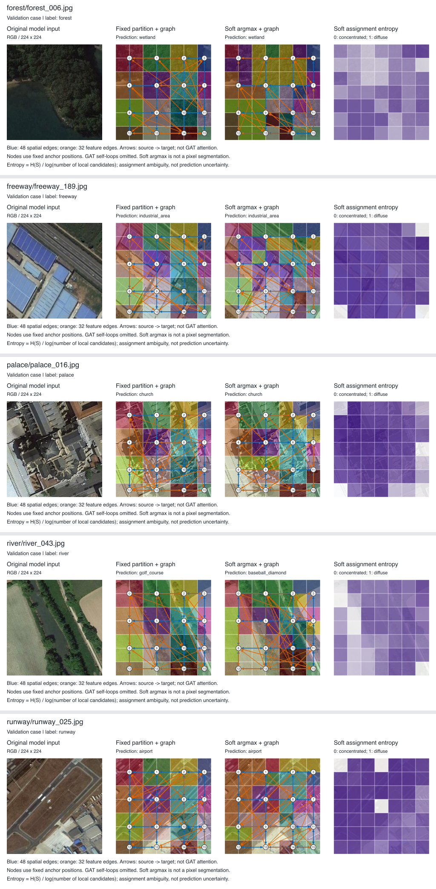

# GAViT：实验结果与讨论初稿

2026-10-12补充：BigEarth soft43正式完成，mAP72.867571%、macro-F1 66.673892%、micro-F1 76.905971%，三项高于旧43两个对照。[BigEarth43/45共同seed新表](../results/bigearth_three_model_two_seed_summary.md)显示soft相对fixed两次mAP升、相对Swin一升一降；旧43 fixed保存21轮和打印精度/代码/硬件限制需正文披露。两个数据集三模型现在各有两seed，最终三seed仍有缺口。下方正文是10-06阶段初稿，n=1描述与表格定稿时须使用新表替换。

2026-10-11补充：NWPU seed43三模型正式结果已回传，OA为93.857143/93.765873/93.626984%（Swin/固定/soft）。[NWPU双seed新表](../results/nwpu_two_seed_summary.md)已保存：固定平均仅+0.039683pp且方向不一致，soft两次低于Swin；42/43为2080Ti/4090，仍为有限描述证据。BigEarth soft43预检PASS，训练/test待完成。以下正文保留10-06初稿范围；其中NWPU仅seed42与软分配n=1的措辞定稿时须用新表替换，不能当当前完整重复数。

更新：2026-10-06。本文整合截至10-05已归档的实验结果，供论文实验与讨论章节使用。数值来自项目已有报告和结构化摘要，本次没有训练、重新推理或新增测试集评估。它是当前证据的正文初稿，外部方法比较和若干多seed结果仍未齐备；最后一节列出定稿缺口。

## 1. 研究问题与实验设计

本研究考察：在Swin-T已有表征上加入区域分组和图推理，能否带来稳定、可解释且值得额外计算开销的分类收益。实验依次检验固定区域图相对骨干的收益、可学习分组相对固定网格的变化，以及在收益不足时，两项针对反馈接口的有限解释是否获得支持。主要判断依据是完整测试集及预先确定的指标，案例图和验证诊断用于补充解释。

### 1.1 数据划分与模型选择

| 数据集 | 标签任务 | 校准/训练样本 | 验证样本 | 最终拟合样本 | 测试样本 | 本文重复范围 |
|---|---|---:|---:|---:|---:|---|
| AID | 30类单标签 | 4,000 | 1,000 | 5,000 | 5,000 | Swin与固定GAViT：训练seed42/43/44 |
| NWPU-RESISC45 | 45类单标签 | 5,040 | 1,260 | 6,300 | 25,200 | Swin、固定与软分组：训练seed42 |
| BigEarthNet-19 | 19类多标签 | 237,871 | 122,342 | 不合并train/val | 119,825 | Swin/固定：历史42/43/44/45；软分组：45 |

AID使用50%训练池，NWPU使用20%训练池；训练池内再按80%/20%划分校准训练与验证。外层划分seed为42，内部验证划分seed为4242，清单固定后供模型复用。校准上限为30轮，按最高验证OA选择轮数，同分取首次达到的轮次。随后从共同ImageNet预训练重新初始化，在完整训练池上拟合所选轮数，并保留Cosine调度周期30，最后评估测试集。因此，最终测试权重并非校准best的继续训练或直接测试。

AID与NWPU分别发现1组和8组同类像素完全重复图片。全部图片保留，但每组限制在同一split内，避免这些已识别重复跨split。该检查不等于排除所有近重复或地理相关性。AID共9,999张独立像素图像，NWPU为31,492张；报告样本数仍按实际保留图片数计算。[数据协议](experiment_matrix_20260919.md)

BigEarthNet保持原train/val/test划分，按验证mAP选择best后测试，不合并训练和验证集。历史四seed结果包含执行条件差异，须按第2.2节解释。不同训练seed共用固定测试集，不能把多次预测累计成更多独立测试图片，也不能把固定划分下训练重复与多次随机划分实验等同。

### 1.2 实现与指标

当前比较采用ImageNet预训练Swin-T、224×224 RGB输入、batch32、AdamW（学习率0.0003，weight decay 0.0001）与30轮Cosine调度。单标签入口使用交叉熵、固定的双向翻转与色彩扰动，报告OA、macro-F1及逐类/混淆结果。BigEarthNet只使用RGB三个波段，使用BCEWithLogitsLoss，以19类AP的宏平均mAP为主指标，同时报告macro-F1和micro-F1，分类阈值固定0.5。本实验不代表完整多光谱输入设置。

两套流程均使用FP32、无AMP；AID/NWPU关闭matmul和cuDNN的TF32，BigEarthNet保留cuDNN TF32设置、关闭matmul TF32。共同设置在数据集内部核对，不把不同任务的损失、标签或选模方式强行视为相同协议。完整环境与身份见各来源报告。

固定GAViT将末级49个token按4×4空间区域做注意力汇总，构建48条空间边及32条特征边，通过图推理后将区域反馈加回token，再全局平均分类。软分组版本使用局部区域原型和共享128维投影，温度0.1，Chebyshev半径1的候选限制及一次分配，联合改变区域汇总和软反馈；空间图仍沿用锚点邻接。它是受空间先验约束的内容依赖分组，并非任意形状语义分割，也未学习全部空间图几何。[结构定义与边界](../results/soft_assignment_cross_dataset_ablation.md)

以下多seed统计均使用样本标准差（ddof=1）；配对差先按同seed计算，再求均值和标准差。百分比指标之差记为百分点（pp）。单seed表不填标准差，不据小差距宣称显著性或稳定性。

## 2. 固定区域图是否提供稳定收益

### 2.1 AID：三次训练重复的平均收益接近零

| 训练seed | Swin OA % | 固定GAViT OA % | ΔOA pp | Swin macro-F1 % | 固定GAViT macro-F1 % |
|---|---:|---:|---:|---:|---:|
| 42 | 96.34 | 96.94 | +0.60 | 96.2209 | 96.7811 |
| 43 | 96.86 | 97.16 | +0.30 | 96.6842 | 96.9559 |
| 44 | 96.84 | 96.08 | -0.76 | 96.6611 | 95.8746 |

| 指标 | Swin均值±SD | 固定GAViT均值±SD | 配对差均值±SD（pp） |
|---|---:|---:|---:|
| OA % | 96.6800 ± 0.2946 | 96.7267 ± 0.5707 | +0.0467 ± 0.7145 |
| macro-F1 % | 96.5221 ± 0.2611 | 96.5372 ± 0.5804 | +0.0151 ± 0.7091 |

三次运行中两次OA改善、一次下降。配对预测显示，seed42纠正93个错误同时新增63个，seed43为62/47，seed44为60/98；净变化分别为+30、+15和-38。当前结果未显示稳定的整体收益，且不能把接近零的均值差解释为已经证明两模型等效。GAViT在这三次的SD较大，也仅是本组运行的观察。所有预定seed均保留，未因seed44不利而替换或重跑。[完整结果与逐类分析入口](../results/aid_multiseed_summary.md)

### 2.2 BigEarthNet：四seed历史结果的方向并不一致

| 训练seed | Swin mAP % | 固定GAViT mAP % | ΔmAP pp |
|---|---:|---:|---:|
| 42 | 70.9 | 72.0 | +1.1 |
| 43 | 71.1 | 71.7 | +0.6 |
| 44 | 71.4 | 70.2 | -1.2 |
| 45 | 71.6769 | 70.2582 | -1.4187 |

| 指标 | Swin均值±SD（约） | 固定GAViT均值±SD（约） | 配对差均值±SD（pp，约） |
|---|---:|---:|---:|
| mAP % | 71.27 ± 0.34 | 71.04 ± 0.94 | -0.23 ± 1.27 |
| macro-F1 % | 64.77 ± 0.76 | 65.30 ± 0.75 | +0.53 ± 1.36 |
| micro-F1 % | 76.51 ± 0.34 | 76.83 ± 0.19 | +0.32 ± 0.37 |

这些是全部预定seed的描述性汇总。seed42–44保留历史一位小数报告，seed45使用精确值，故汇总精度受历史舍入限制。GAViT43/44历史记录分别停在21/26轮，Swin44仅确认日志到27轮且最终训练退出未确认；seed45双方均完成30轮并有退出码0。硬件与执行条件也并非完全一致。因此，这组SD不能解释为仅由训练随机seed产生的方差，也不能替代严格匹配条件的四次完整重复。

主指标mAP两次改善、两次下降，平均配对差约-0.23 pp；macro-F1和micro-F1均值正向，不改变预先指定的mAP判断。早期两个seed的积极信号尚未形成四seed稳定优势。保留中断与不利结果，能避免仅展示有利运行造成的选择偏差。[四seed来源及限制](../results/bigearth_four_seed_summary.md)

## 3. 可学习分组的双数据集正式消融

### 3.1 NWPU-RESISC45：seed42，25,200张测试图像

| 模型 | OA % | macro-F1 % | 参数量 M | 最终拟合轮数 |
|---|---:|---:|---:|---:|
| Swin-T | 93.9325 | 93.9091 | 27.5555 | 29 |
| 固定4×4 GAViT | 94.1032 | 94.0899 | 31.3869 | 29 |
| 软分组GAViT | 93.8690 | 93.8550 | 31.4868 | 28 |

软分组比固定分组低0.2341 pp OA，比Swin低0.0635 pp。相对固定模型，它纠正538个错误但新增597个，净少对59张；相对Swin纠正570个、新增586个，净少对16张。收益与损害同时存在，不能只展示改善案例。校准阶段soft比fixed高0.7143 pp，最终refit/test却反向；由于模型经过独立重新拟合，不能把这一排序变化当成同一checkpoint从验证到测试的过拟合证据。[正式测试与配对分析](../results/nwpu_seed42_closeout.md)

### 3.2 BigEarthNet-19：seed45，119,825张测试图像

| 模型 | mAP % | macro-F1 % | micro-F1 % | 参数量 M |
|---|---:|---:|---:|---:|
| Swin-T | 71.6769 | 65.0842 | 76.7323 | 27.5355 |
| 固定4×4 GAViT | 70.2582 | 64.2955 | 76.7025 | 31.3669 |
| 软分组GAViT | 70.8369 | 64.8648 | 76.3834 | 31.4668 |

软分组相对固定分组的mAP与macro-F1分别提高0.5787和0.5693 pp，micro-F1下降0.3191 pp；三项指标仍低于Swin。19类AP中12升7降，海岸湿地AP增加15.7108 pp，贡献0.8269 pp宏平均mAP；其余18类的合计贡献为-0.2482 pp，二者相加得到0.5787 pp净增。该分解保留全部类别，没有删除不利类别或重新定义主指标。AP描述排序，F1还依赖固定阈值；这能说明两类指标可能不同向，但尚不能确定本次micro-F1下降的具体机制。

本组复用已完成的seed45固定模型和Swin对照，仅增加soft运行。split、预训练及主要训练配方保持一致，旧对照代码为deb2b45，soft为ed480e6；GPU同为RTX2080Ti，但物理UUID不同，不能声称环境完全相同。[正式结果与全部19类AP](../results/bigearth_soft45_ablation.md)

两个数据集各只有一个soft seed，不能将NWPU42与BigEarth45合称两个重复实验，也不能平均OA和mAP形成跨任务“总体收益”。当前可得结论是：这一具体软分组实现具有条件性收益，但未建立相对Swin的稳定优势。它同时改变原型投影、区域聚合和反馈映射，因此实验没有单独分离“内容依赖”“软化”与额外参数的贡献。[精确六行主表](../results/soft_assignment_cross_dataset_summary.json)

## 4. 结构变化与失败分析

### 4.1 分组发生变化，不等于语义质量已改善

可微路径、归一化、存盘重载及真实图边检查确认软分组能被训练并参与前向。NWPU预定90张验证案例（45类各按路径取前两张）的图册中，39.09%的token最大归属ID变化，两个模型的有向特征边共有比例为34.44%。这说明分组和构造图确实不同，但分别训练的模型不能提供单模块即时因果归因。

90例中固定模型正确82张，soft正确85张，包含3例纠正、0例新增错误与5例共同错误。该子集使用校准best，并非第3节refit权重或测试集；局部正向结果不能替代完整test净少对59张的结果。案例中仍有混合地物、狭长目标和细粒度类别混淆。现有图像未提供一致语义区域改善的证据；同时，分类监督本来也不要求分组等同地物分割。

图1：预定90例中的全部3例纠正。分区显示最大软归属，蓝/橙箭头表示48条空间和32条特征构造边，节点绘于固定锚点。边不编码GAT注意力强度，位置也不表示软区域的实际质心。图的选择范围固定，不作为总体性能或机制因果证据。

图2：同一90例中的全部5例共同错误。分组变化未消除森林/湿地、宫殿/教堂等混淆；原图的混合内容只是可见线索，不能据此修改标签或确定模型依赖对象。[完整审图与图注](../results/nwpu_regions_visual_review_20260930.md)

8张固定验证探针显示投影原型相似度和分配熵上升，但它们不是跨45类分层样本，投影原型也不是最终区域特征。非零软质量、没有低范数原型，以及某区域没有argmax赢家，不能共同推出“全局塌缩”，也不能证明所有区域均有判别性。现有证据不足以确认过度平滑或区域坍缩是根因。

### 4.2 简单减弱反馈的假设未获得支持

冻结NWPU seed42的fixed与soft校准best，在完整1,260张验证图上测试预设反馈幅度α=0、0.25、0.5、0.75、1。全部低于原幅度的设置均降低OA和macro-F1，并提高交叉熵；α=1在这五档中最好。完全关闭反馈时，fixed纠正8个错误、新增17个，soft纠正12个、新增21个，两者均净少对9张，即OA下降0.7143 pp。

这组结果不支持用简单整体缩小反馈修复当前差距。α=0仍保留联合训练得到的骨干与分类器，不能当作独立训练的无图基线；模型依赖自己的反馈也不证明加图优于单独Swin。诊断限于这些冻结权重、验证集与预设幅度，不外推为BigEarth的误差原因。[完整五档结果](../results/nwpu_feedback_sensitivity_seed42.md)

### 4.3 反馈后增加轻量FFN仍未改善校准结果

原soft版本在反馈后立即平均池化。给定token x、区域反馈F与软归属S，其池化结果可写为mean(x)+Σk[Σi S_ik/N]F_k，表明此处映射经池化后体现为区域总质量加权。这个代数关系不意味着S无效，因为S还影响上游区域表示、图与F。为检验增加逐token非线性是否有帮助，额外进行了一次有界校准：Swin和soft均加同初始化、同参数量的残差FFN（768→192→768，末层零初始化），放在池化前；soft位于反馈后。每个模型增加297,408参数。该FFN共享于各token，并不执行token间交互。

| 模型 | 验证OA % | 验证macro-F1 % | 最佳轮 | 正确数/1,260 |
|---|---:|---:|---:|---:|
| Swin-T | 94.2063 | 94.1716 | 29 | 1,187 |
| Swin-T + FFN | 94.0476 | 94.0447 | 29 | 1,185 |
| 软分组GAViT | 93.7302 | 93.7657 | 28 | 1,181 |
| 软分组GAViT + FFN | 93.1746 | 93.1457 | 22 | 1,174 |

两项新实验均完成30轮，使用5040/1260校准划分和seed42，旧无FFN对照复用。Swin+FFN比原版低0.1587 pp OA，soft+FFN比原soft低0.5556 pp；soft+FFN也未超过Swin+FFN或原Swin，全部预设继续条件失败。对原soft的配对结果为纠正27个、新增34个，净少对7张。该候选据此停止，没有追加seed、refit或正式test；不能把表中验证分数写入第3节正式测试表。

soft+FFN的最佳轮从28提前到22不足以单独证明过拟合：新旧soft最后一轮相对各自best都少对3张。工程检查表明零初始化与梯度更新按预期工作，但不意味着新增容量必然提高泛化。本次结果只否定这套具体FFN设置的继续依据，不证明所有非线性反馈设计均无效。[完整四格表、缓存核验与资源](../results/nwpu_ffn_calibration42_comparison.md)

上述两项诊断支持收窄结论：已经检查的简单反馈幅度调整与逐tokenFFN没有改善当前校准表现；错误根因仍不能唯一定位到分组、图关系或优化过程。局部候选限制、原型趋同和训练随机性可以作为待检验解释，不能写成已证实因果。

## 5. 准确率收益与计算代价

| AID seed42，RTX2080Ti模型前向 | Swin-T | 固定GAViT | GAViT相对变化 |
|---|---:|---:|---:|
| 参数量 M | 27.5440 | 31.3754 | +13.91% |
| batch1平均延迟 ms | 14.891 | 20.016 | +34.41% |
| batch32吞吐 图/秒 | 564.892 | 478.433 | -15.31% |
| batch32峰值allocated MiB | 594.482 | 609.353 | +2.50% |

该测量使用已驻留GPU的224×224合成输入、FP32，20次预热后进行5组各50次同步计时，排除数据读取、预处理与传输；显存口径不含加载/重建峰值。它是一次同卡模型前向比较，五组计时不构成五次训练重复，也不能称为完整数据集处理吞吐。原始逐次计时仍在服务器，本地保存并核验的是回传摘要。[测量范围与精确数据](../results/aid_efficiency_summary.md)

结合AID三seed接近零的平均增益，当前固定区域图没有显示足以支撑这些额外开销的稳定整体收益。soft相对fixed只增加99,840参数，但参数增量不能替代真实速度与显存测量。BigEarth soft45整批耗时约14小时44分、训练峰值allocated约3.660 GiB，是含验证、IO等的执行成本；不同物理卡及运行条件下的训练总时间不用于公平推理效率排名。soft和FFN的新结构公平推理效率仍未测。

## 6. 当前结论与证据边界

已有结果支持将GAViT描述为一次有可追溯实现、对照和失败分析的区域图建模研究。固定分组在AID的三次训练重复中未显示稳定优势；BigEarth历史四seed主指标方向混合。局部原型软分配改变了区域与图结构，在BigEarth某些类别取得改善，但没有在当前两个数据集的单seed测试中超过Swin。两项有界反馈诊断亦未找到可直接修复差距的简单方案。

这些观察说明“表示更灵活”本身不足以保证分类提升。收益取决于形成的区域表示、关系推理、反馈接口及监督目标能否共同保留判别信息；目前的实验没有独立识别各因素的因果贡献。本文不声称软分配普遍无效、不声称已经找到唯一根因，也不以局部可视化替代整体量化。

本稿的验证范围是已归档服务器报告、返回的缓存核验及本地算术复核，并非本次重新执行GPU实验。多处完整checkpoint、预测或计时仍保存在服务器，不能把本地结果摘要称为所有原始产物已完整备份。原始日志、身份与负面结果继续保留。

## 7. 定稿前仍需处理的要求

| 导师/项目要求 | 当前状态 | 剩余工作及限制 |
|---|---|---|
| AID第三基准 | 固定模型三seed与效率摘要完成 | 外部方法主比较尚未覆盖；未做AID软分组，不冒称已有 |
| BigEarth至少四seed核心对比 | 四seed历史描述性汇总完成 | 中断、舍入与硬件差异须披露；不能冒充严格同条件重复 |
| NWPU与BigEarth三模型软分配消融 | 各一个seed正式test与解释已完成 | 多seed消融仍不足；后续预算和候选范围须按负面筛选规则明确，不能默认扩训 |
| HGTNet、DFAGCN统一协议比较 | 论文身份及材料缺口已核对；用户报告尚无作者回复 | 取得材料或明确独立重实现路线、核对完整方法、冻结共同协议并做多seed；当前无本项目实测分数 |
| 区域/图边可视化 | NWPU固定90例已审阅，正反例保留 | fixed/soft图册不等同于导师提出的3×3/4×4受控比较；不能声称语义质量已证实改善 |
| 三条相关工作主线 | 有方法审计与本稿引用入口 | 遥感Transformer、图像GNN、区域分组的完整文献章节仍须补齐原始文献与差异论证 |
| 效率 | 固定模型AID同卡前向完成 | 新结构公平效率、完整输入处理链未测；后者不作为其他导师要求的前置任务 |

截至本轮，继续工作优先转向外部比较材料与论文整合，不重复已关闭FFN候选。外部代码尚未取得不代表论文未发表；论文报告值也不能填进本项目统一协议的实测表。当前状态与接入条件见[10-06公开材料复查](external_methods_refresh_20261006.md)、[导师原文和逐项状态](supervisor_latest_email_received_20260924.md)。

### 数值与来源索引

本文表格分别对应以下机器可读摘要；本次校验记录列出文件SHA和表格核对范围：[核验记录](../results/evidence/thesis_synthesis_20261006/validation.json)。

- [AID三seed](../results/aid_multiseed_summary.json)
- [BigEarth四seed](../results/bigearth_four_seed_summary.json)
- [双数据集软分组正式六行表](../results/soft_assignment_cross_dataset_summary.json)
- [AID效率](../results/aid_efficiency_summary.json)
- [FFN校准与配对](../results/nwpu_ffn_calibration42_summary.json)

旧的`comparison_table.csv`与`ablation_study.csv`含早期NWPU协议和近似值，未用于本文新协议主表。所有章节暂按研究问题编号，最终论文编号、文献格式及学校模板尚未套用。
