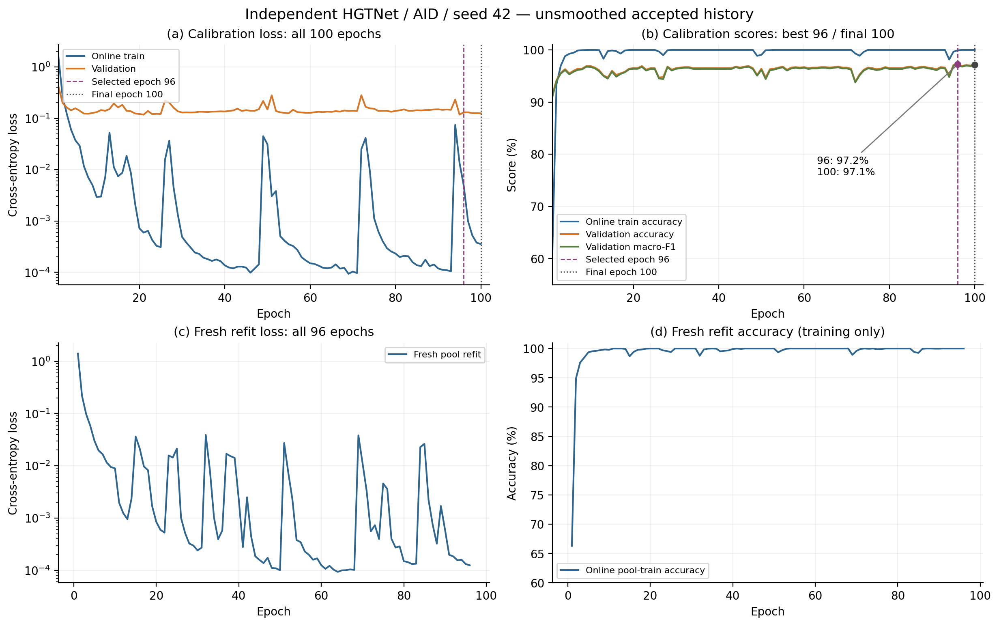
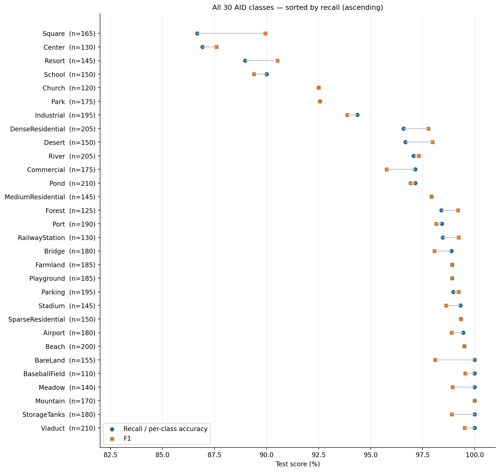
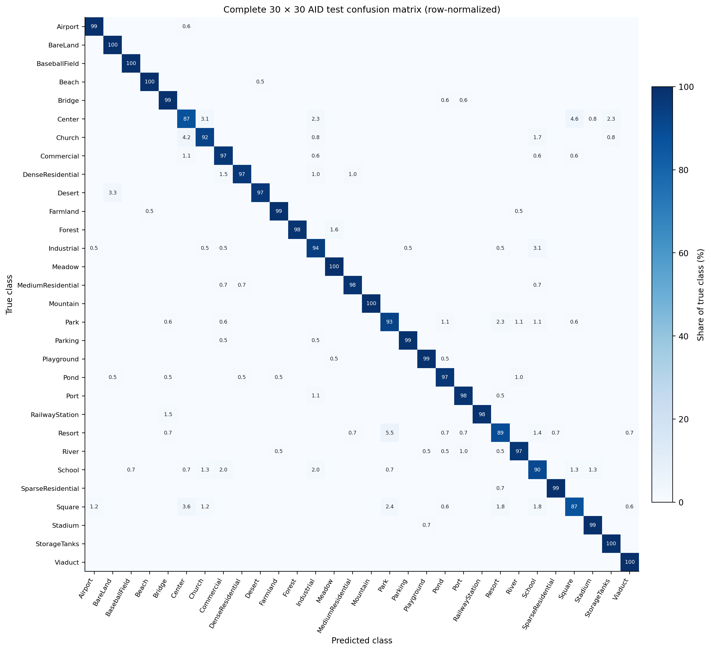
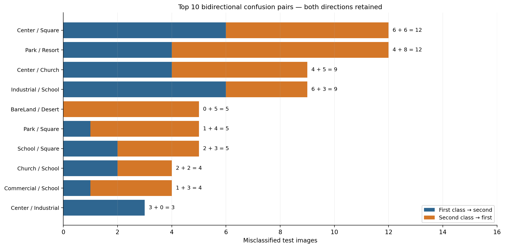

# HGTNet AID seed42 离线诊断（2026-11-06）

从原manifest和5000条有序预测独立重算：Accuracy **96.92%**，macro-F1 **96.772868149320%**；4846正确、154错误。全部30类和30×30混淆矩阵与现有root/独立审计一致。

这是单seed独立非官方实现的完整方法比较。类别与混淆分析属于描述性诊断，不能据此推断图模块因果贡献、统计显著性或统一配方优势。

## 数据与选择

- 原AID manifest SHA256：`30ac5760bf0c002c9a7fe788a0d19fc4caf0b6f7cccb7d71d959ee0d2903aa22`。固定train4000、val1000、fresh pool5000、test5000；30类不等量；原Industrial两张重复图均在train。
- 全部测试路径和标签必须逐项等于原manifest有序test split；遇到错序或标签变化直接拒绝，不自动对齐。46项下载文件SHA/大小再次核对；所有原始文件保持不变。
- 校准100轮，按验证正确数严格增加选择最早最佳轮96：验证Accuracy 97.20%，macro-F1 97.074556951978%。
- 最后校准轮100：验证Accuracy 97.10%，macro-F1 96.990537879703%，loss 0.124729463208；训练Accuracy 100.00%，loss 0.000355966208。
- 等初态fresh pool refit96轮；末轮训练Accuracy 100.00%，loss 0.000124556058。55048次接受更新；训练100%不等于test指标。

## 全类别与混淆

| Class | Support | Errors | Recall (%) | F1 (%) |
|---|---:|---:|---:|---:|
| Airport | 180 | 1 | 99.444444 | 98.895028 |
| BareLand | 155 | 0 | 100.000000 | 98.101266 |
| BaseballField | 110 | 0 | 100.000000 | 99.547511 |
| Beach | 200 | 1 | 99.500000 | 99.500000 |
| Bridge | 180 | 2 | 98.888889 | 98.071625 |
| Center | 130 | 17 | 86.923077 | 87.596899 |
| Church | 120 | 9 | 92.500000 | 92.500000 |
| Commercial | 175 | 5 | 97.142857 | 95.774648 |
| DenseResidential | 205 | 7 | 96.585366 | 97.777778 |
| Desert | 150 | 5 | 96.666667 | 97.972973 |
| Farmland | 185 | 2 | 98.918919 | 98.918919 |
| Forest | 125 | 2 | 98.400000 | 99.193548 |
| Industrial | 195 | 11 | 94.358974 | 93.877551 |
| Meadow | 140 | 0 | 100.000000 | 98.939929 |
| MediumResidential | 145 | 3 | 97.931034 | 97.931034 |
| Mountain | 170 | 0 | 100.000000 | 100.000000 |
| Park | 175 | 13 | 92.571429 | 92.571429 |
| Parking | 195 | 2 | 98.974359 | 99.228792 |
| Playground | 185 | 2 | 98.918919 | 98.918919 |
| Pond | 210 | 6 | 97.142857 | 96.912114 |
| Port | 190 | 3 | 98.421053 | 98.162730 |
| RailwayStation | 130 | 2 | 98.461538 | 99.224806 |
| Resort | 145 | 16 | 88.965517 | 90.526316 |
| River | 205 | 6 | 97.073171 | 97.310513 |
| School | 150 | 15 | 90.000000 | 89.403974 |
| SparseResidential | 150 | 1 | 99.333333 | 99.333333 |
| Square | 165 | 22 | 86.666667 | 89.937107 |
| Stadium | 145 | 1 | 99.310345 | 98.630137 |
| StorageTanks | 180 | 0 | 100.000000 | 98.901099 |
| Viaduct | 210 | 0 | 100.000000 | 99.526066 |

低召回类别依次为：Square 86.67% (22/165错)、Center 86.92% (17/130错)、Resort 88.97% (16/145错)、School 90.00% (15/150错)、Church 92.50% (9/120错)、Park 92.57% (13/175错)。这是该已训练模型在固定test split上的分布，不代表全数据集或模块机制。

全部870个非对角方向（含零）保存在CSV，其中83个方向非零、合计154张错图；435个无序类别对保留双向计数。下面仅按合计错数列出前10对，不能替代完整矩阵。

| Class A | Class B | A → B | B → A | Total |
|---|---|---:|---:|---:|
| Center | Square | 6 | 6 | 12 |
| Park | Resort | 4 | 8 | 12 |
| Center | Church | 4 | 5 | 9 |
| Industrial | School | 6 | 3 | 9 |
| BareLand | Desert | 0 | 5 | 5 |
| Park | Square | 1 | 4 | 5 |
| School | Square | 2 | 3 | 5 |
| Church | School | 2 | 2 | 4 |
| Commercial | School | 1 | 3 | 4 |
| Center | Industrial | 3 | 0 | 3 |

## 完整训练历史与资源范围

模型参数74,612,163，均可训练。当前完成summary的attempt2墙钟4986.588286秒（83.11分钟），峰值allocated 4.406250 GiB、reserved 4.820312 GiB；仅覆盖恢复后的当前调用。全实验墙钟、全程峰值与费用均未获得。
恢复按refit75已接受提交继续，旧实例180次未提交更新被丢弃并重算，未双计。历史CSV保留全部100+96轮；refit75没有epoch_wall_seconds，空值保留。可获得的轮时求和只覆盖接受轨迹中已记录的完整轮，排除废弃更新、setup等，不能当总耗时或账单。
最终test评估记录100.912883秒；其测量范围不是跨硬件推理速度基准。模型重载误差0属于服务器原记录，本分析没有本地下载/加载大模型。

在线train指标聚合轮内不断变化的参数，validation是轮末评估；fresh refit没有validation。全部轮次原样绘制，无平滑或挑选。best96和final100同时标注。

## 工件

- [per_class](hgtnet_aid_seed42_per_class_20261106.csv)
- [predictions](hgtnet_aid_seed42_predictions_20261106.csv)
- [errors](hgtnet_aid_seed42_errors_20261106.csv)
- [confusions](hgtnet_aid_seed42_confusions_20261106.csv)
- [confusion_pairs](hgtnet_aid_seed42_confusion_pairs_20261106.csv)
- [history](hgtnet_aid_seed42_history_20261106.csv)
- [confusion_matrix](hgtnet_aid_seed42_confusion_matrix_20261106.csv)

四张图均提供PNG和SVG。CM为按true-class support归一化，true为行、predicted为列，保留全部类别与对角线。

[SVG](figures/hgtnet_aid_seed42_20261106/hgtnet_aid_seed42_training_history.svg)

[SVG](figures/hgtnet_aid_seed42_20261106/hgtnet_aid_seed42_all_class_performance.svg)

[SVG](figures/hgtnet_aid_seed42_20261106/hgtnet_aid_seed42_confusion_matrix.svg)

[SVG](figures/hgtnet_aid_seed42_20261106/hgtnet_aid_seed42_top10_bidirectional_confusions.svg)

## 复现边界

脚本只读原JSON、下载清单和现有两个审计，使用标准库重算全部指标；仅绘图时导入Matplotlib/Numpy。没有网络、GPU模型执行、新训练、图片解码或test前向。没有从aggregate总数推断与Swin/GAViT配对的纠正/新增错误数。
