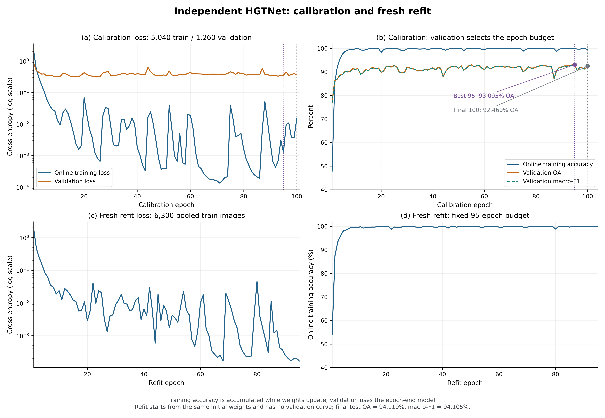
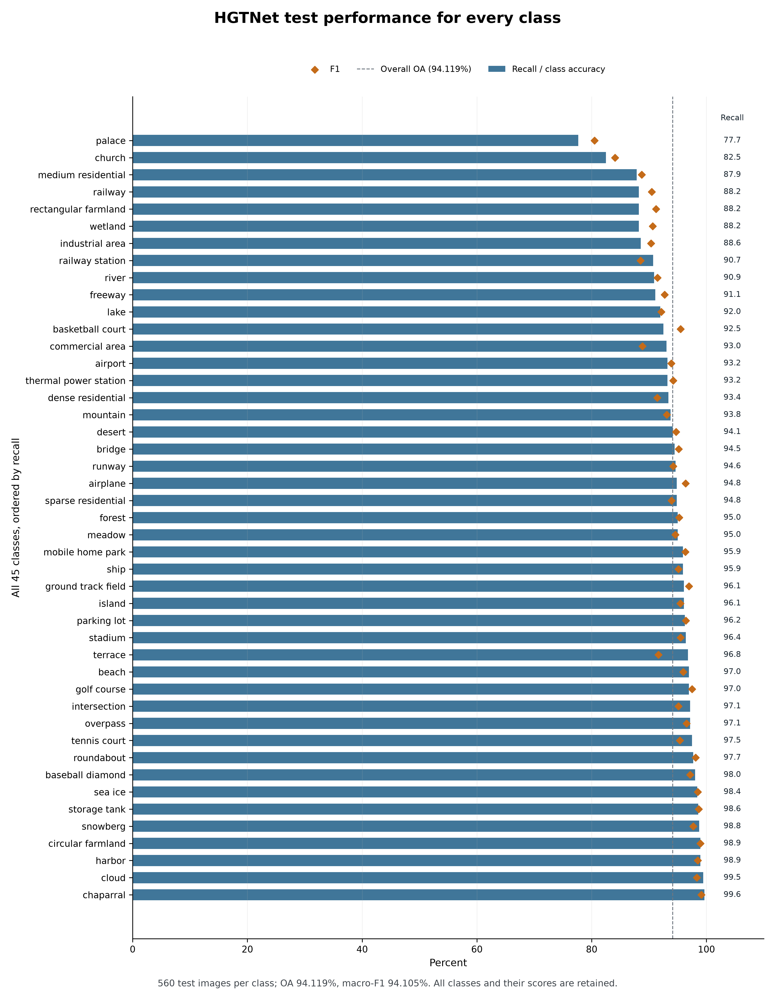
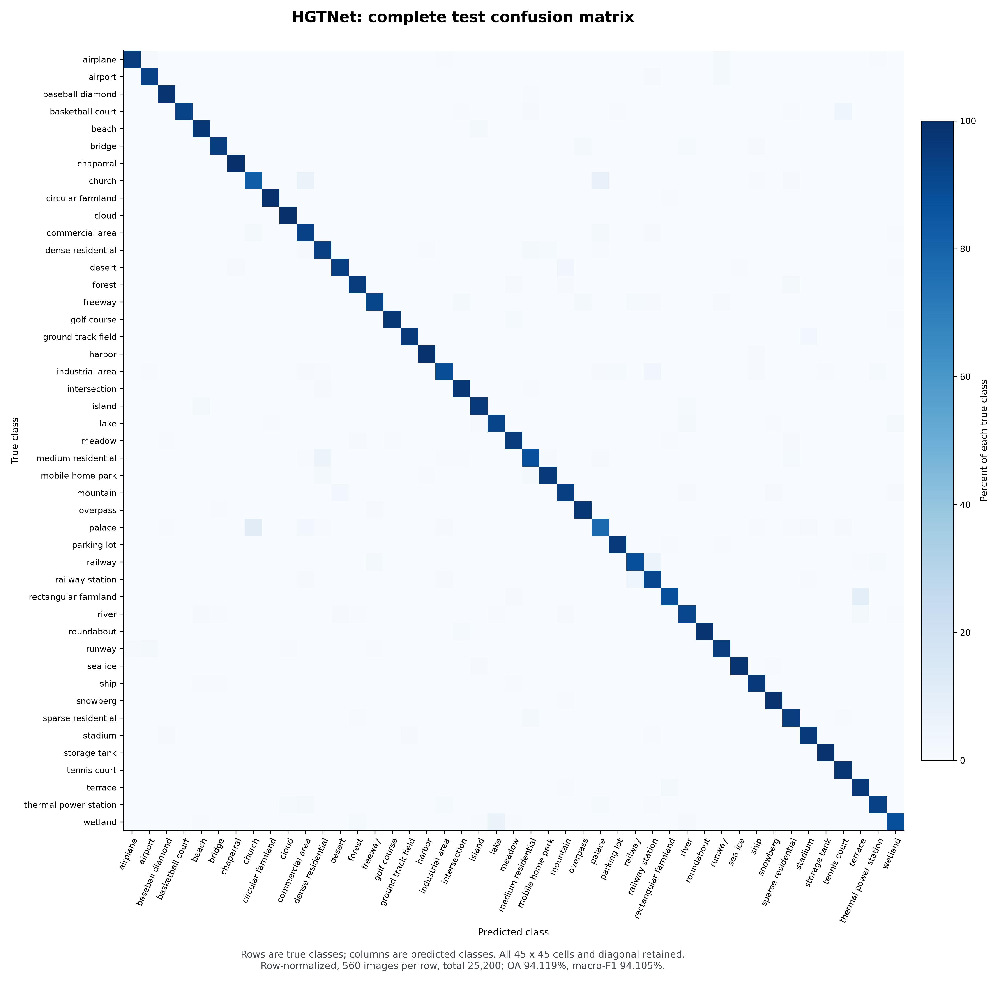
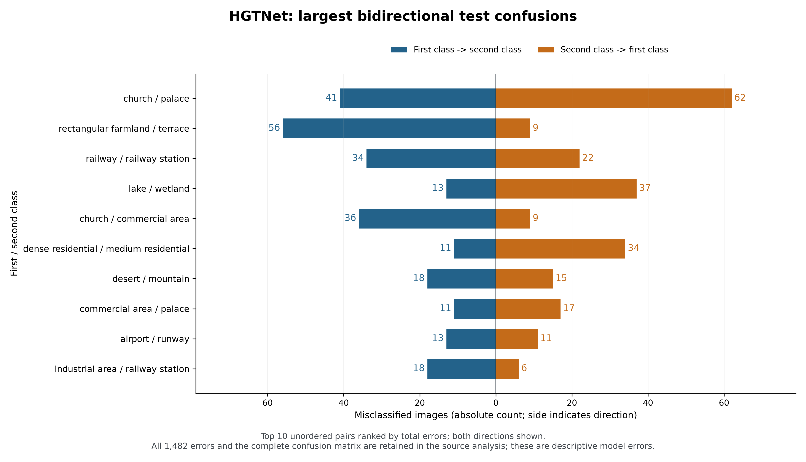

# HGTNet seed42：独立复算、训练曲线与错误分析

2026-11-04完成离线分析。**25200条预测、45类指标、全部2025个混淆矩阵单元与100轮校准/95轮重新训练记录均核对通过。** 原test文件SHA与服务器完成时报告完全相同；结果从“服务器摘要已验收”升级为“原始预测与历史已回收、本地独立复算通过”。未重新训练或使用GPU。

## 核心结果

- Test Accuracy：**94.11904761904762%**。
- Test macro-F1：**94.10529172930384%**。
- 25200张中23718张正确、1482张错误；45类各560张。由每张路径的类别目录重建真值，与绑定清单、返回labels及逐图预测逐项一致。
- 校准100轮，按验证正确数严格提高/平手最早的规则，**第95轮为唯一最佳轮**。Fresh相同初值在6300张训练池上重新训练95轮，总68930次更新。
- 独立公式重算OA/macro-F1与返回值差异均为0；完整逐类recall/precision/F1及混淆矩阵已导出，未只保留最好类别。

[逐类数据](hgtnet_nwpu_seed42_per_class_20261104.csv)、[全部预测](hgtnet_nwpu_seed42_predictions_20261104.csv)、[全部错误](hgtnet_nwpu_seed42_errors_20261104.csv)、[完整混淆矩阵](hgtnet_nwpu_seed42_confusion_matrix_20261104.csv)、[机器分析记录](hgtnet_nwpu_seed42_analysis_20261104.json)。

## 最佳轮与末轮同时报告

第95轮：验证OA93.0952380952381%、macro-F193.03452094979133%，1173/1260正确，val loss0.3547356235；训练在线accuracy99.96031746%、loss0.0012817842。

第100轮：验证OA92.46031746031746%、macro-F192.42454111106593%，1165/1260正确，val loss0.3699770268；训练在线accuracy99.52380952%、loss0.0147822473。

最佳到末轮验证OA下降0.6349206349个百分点，对应少正确8张。这说明不能用第100轮结果替代已预定的最佳轮选择，也不能只展示第95轮而隐藏后续波动。曲线本身不识别波动的因果原因。训练指标在权重不断更新、随机增强过程中累计；validation是轮末固定模型的评估，两者不宜直接解释成同一模型/同一输入口径的泛化差距。

Refit第95轮在线训练accuracy100%、loss0.0001678269；refit没有validation曲线。最终test模型是在完整6300图训练池上重新训练得到的模型，不是直接拿校准best权重测试；test与validation分数差异不能简单归因“在test上提升”或“过拟合”。

[训练历史CSV](hgtnet_nwpu_seed42_history_20261104.csv)；矢量版：[PDF](evidence/hgtnet_results_return_20261104/figures/hgtnet_seed42_training_history.pdf)、[SVG](evidence/hgtnet_results_return_20261104/figures/hgtnet_seed42_training_history.svg)。全部轮次保留，图中标明best95/final100。

## 类别和混淆

低召回类别包括palace77.6786%（435/560）、church82.5000%（462/560）、medium_residential87.8571%（492/560）；railway、rectangular_farmland、wetland均为88.2143%（494/560）。全45类及并列值均保留在CSV和图中。

最大的双向混淆为church/palace：church→palace41张、palace→church62张，共103张，占全部1482个错误的6.9501%。其次rectangular_farmland/terrace为56/9，共65；railway/railway_station为34/22，共56；lake/wetland为13/37，共50。前五双向类别对合计占错误21.5250%。这些是错误分布描述；没有原图不能直接断言视觉原因，也不能归因图传播。

[所有有向混淆](hgtnet_nwpu_seed42_confusions_20261104.csv)和[所有双向类别对](hgtnet_nwpu_seed42_confusion_pairs_20261104.csv)保留完整方向；图仅按总错误数选择前十，不删掉反方向。

## 相对DFAGCN的逐图变化

两份已回收结果的manifest引用、类别和25200条有序路径完全一致，因而可以做这个固定测试集上的逐图描述：

- 双方都正确：21303张。
- DF错误、HGT正确：2415张。
- DF正确、HGT错误：503张。
- 双方都错误：979张。

纠正2415−退化503＝净增加1912张正确，吻合94.1190%−86.5317%＝7.5873个百分点；正负方向均保留在[全部配对记录](hgtnet_nwpu_seed42_paired_vs_dfagcn_20261104.csv)。这是两套完整方法的结果差异，骨干、预训练、优化及训练流程不同，不能单独归因图模块。

## 与GAViT的可用结论

当前fixed4×4的seed42 test OA94.10317460%、macro-F194.08993346%，HGT分别高0.01587302和0.01535827个百分点，净正确数只差4张。这是点估计接近，不是统计等价检验或稳定优势结论。本次包没有GAViT逐图原件，不能从净4张推断只纠正4张且没有退化，也不能做HGT↔GAViT配对检验。

Fixed4×4为31,386,920参数，HGT为74,619,858，前者少57.9376%。可报告这一组独立完整方法结果中“准确率接近、fixed参数更少”，但不能忽略骨干/预训练/配方/预算差异，也不能据不同GPU上的耗时宣称同条件更快。[当前比较CSV](external_baselines_nwpu_seed42_20261030.csv)已更新HGT证据等级，原分数及其它四行未改变。

## 实际耗时和资源

- 校准100轮wall合计11778.3426秒，平均117.7834秒/轮；其中训练8674.5667秒、验证897.9829秒。
- Refit95轮wall合计11862.1939秒，平均124.8652秒/轮；其中训练10066.0533秒。
- Test评估计时180.7621秒，25200/该计时＝139.4098图/秒。这包含输入/预处理/传输/前向和标签收集，排除后续部分指标及文件处理，不是纯GPU推理速度。
- Engine在epoch与test评估计时之外还有78.6275秒；wrapper另132.6913秒。合计总wall24032.6174秒＝6小时40分32.6秒，非实际租卡账单时间。
- 峰值allocated4.40946GiB/reserved4.78320GiB，整个engine含诊断/重载；不是NVML整卡或推理专用显存。

完整runtime已回收：Python3.11.8、Torch2.2.2+cu121、torchvision0.17.2+cu121、NumPy1.26.4、Pillow10.3.0、CUDA12.1/cuDNN8902、RTX3090、FP32/seed42/8CPU线程、无AMP/TF32。来源值与交付门禁一致；没有把本地CPU或绘图库版本当服务器版本。

## 可直接用于汇报的表述

我们完成了HGTNet独立实现的NWPU-RESISC45 seed42训练、重新训练和测试，并回收原始预测与训练历史。对25200张测试图的本地独立复算得到Accuracy94.1190%、macro-F194.1053%，与服务器报告一致。验证集按预定规则选中第95轮，完整100轮曲线和末轮结果均予保留。在当前单seed完整方法比较中，HGTNet与固定4×4 GAViT的准确率点估计接近，而固定4×4模型的参数量少约57.94%。这一结果属于已披露配方下的补充外部比较，不构成稳定优势、统计等价或单个图模块因果贡献的证明。

[纯文本可复制版本](../output/hgtnet_seed42_verified_summary_20261104.txt)。

## 证据与边界

[原包与七文件SHA收据](evidence/hgtnet_results_return_20261104/archive_receipt.json)、[主分析742项核验](evidence/hgtnet_results_return_20261104/validation.json)、[独立预测131项审计](evidence/hgtnet_results_return_20261104/review_predictions/validation.json)、[独立历史/来源498项审计](evidence/hgtnet_results_return_20261104/review_history/validation.json)、[图表与视觉核验](evidence/hgtnet_results_return_20261104/figures/visual_validation.json)可复现。原包虽命名.tar.tar，内容为gzip tar，七文件规则读取，没有执行包内指令或代码。

仍未回收模型/optimizer快照张量、原始图片或完整原manifest；metadata中的checkpoint/初值/manifest SHA一致，不等于这些原件字节已独立验证。逐轮validation指标由返回混淆矩阵重算，但逐轮validation预测未回收。论文中的多seed稳定性与单模块因果实验不由本轮替代。本轮没有任何新训练、GPU评估、配方或模型源码修改。
