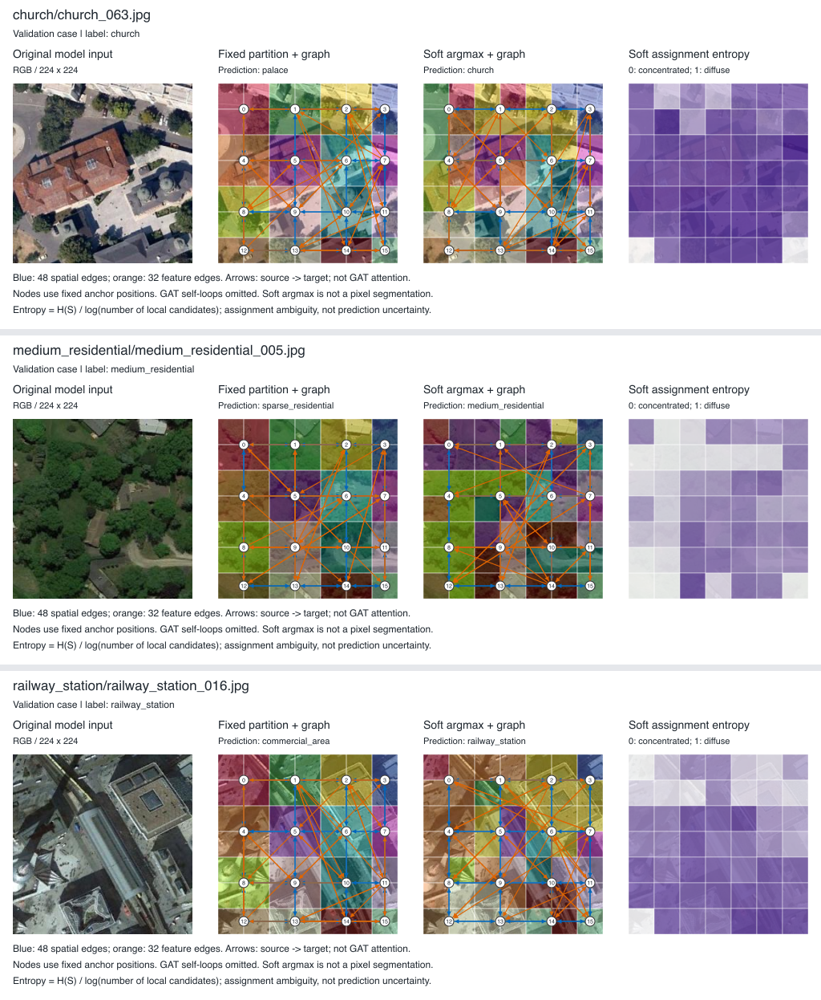
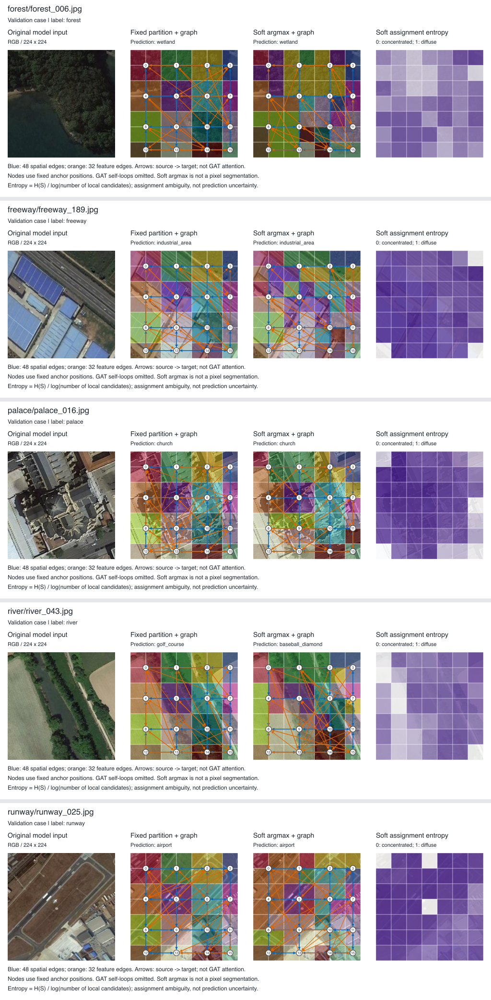

# NWPU seed42 固定与软分配：真实图册审阅

2026-10-01后续更新：用户后来重新确认BigEarth软分配，soft45已完成30轮、正式test及资源归档。本文末尾较早的取消安排已被取代；最新总体结论见[双数据集消融与讨论](soft_assignment_cross_dataset_ablation.md)。图册本身及全部正反例分析保持。

2026-09-30。已读取用户提供的 `cases_compact.html`，逐项解析全部90案例的180个SVG，查看覆盖全部案例的9张总览，以及3个纠正和5个共同错误的原尺寸总览/完整16区域S图。这里只检查本次固定验证案例；没有重新训练、推理或修改模型。

## 结论

软分配改变了token主归属和输入图的特征边，且在这90个案例中纠正3张、没有新增错误。但未观察到足够一致的现象，能支持“软分配通常形成更完整的地物区域”或“特征边普遍连接同类地物”。原型分组是为分类学习的表示，不是语义分割；不能用没有形成单一地物掩码直接判定它失效。也不能将可见变化当作性能变化的因果证明。

正式test仍是Swin 93.932540%、fixed 94.103175%、soft 93.869048%；soft相对fixed净少对59张。本次90例来自校准best的原val，与正式refit/test权重和样本不同，局部+3不能覆盖正式负面结果。

## 文件核验与结构统计

- 原文件43,162,303字节（41.16MiB），相比原图册减少84.43%；字节副本及SHA256存档，SHA256为 `d92ad8c7b4464ebd0a055e685c4cfd99103f8962715d80280f1e04405b724027`。
- 90个唯一图像路径、45类每类2张；180SVG完整可解析。按图中真实标签/两份预测重新计数：双方正确82、soft纠正3、soft新增错误0、双方错误5，与服务器摘要完全一致。没有新增准确率或显著性实验。
- 由SVG的区域ID颜色复算，90张图都改变了至少一个token的主归属；总1724/4410个（39.09%），每图8–30个，均值19.16/49。这只比较`argmax(S)`的锚点ID，不是S矩阵变化幅度，也不是语义边界质量。
- 每图每模型SVG均有48条空间边、32条特征边；对应图的空间边集合相同。两模型共有的有向特征边总992/2880（34.44%），每图2–19条。其余65.56%表示按相同锚点ID对应时的边集合差异；两模型分别训练，不能归因于单一模块的即时干预效果。
- soft的主归属图每例使用12–16个区域ID。某区域没赢得任何token的argmax，不等于该区域S总质量或W汇总为0，不能据此诊断塌缩。
- 本地取得的是渲染图册，未取得90例原始S/W/PT、完整checkpoint或原ZIP。因此未独立复算浮点S/W归一化和前向误差；这些门禁依旧引用上一轮服务器摘要。图像为模型输入224×224缩放版本，不能当作原始256×256数据文件的独立哈希核验。

[逐例结构化清单](evidence/nwpu_regions_review_20260929/gallery_inventory.json)与[显示层统计](evidence/nwpu_regions_review_20260929/display_statistics.json)保留计算来源。

## 全部3个纠正案例

| 案例 | Fixed → Soft | 原图观察与解释边界 |
|---|---|---|
| church/church_063.jpg | palace → church | 大片屋顶、庭院与周围植被同时出现。软归属在屋顶/周边重新分配，但整栋建筑仍跨越多个区域；不能解释成“完整圈住教堂所以纠正”。 |
| medium_residential/medium_residential_005.jpg | sparse_residential → medium_residential | 树冠覆盖许多屋顶，居住密度线索与植被混合。软归属变化较多，部分S图出现集中的横带/局部块；没有证据证明它分离了屋顶与树木或准确估计了密度。 |
| railway_station/railway_station_016.jpg | commercial_area → railway_station | 中央狭长屋面/交通走廊与周围大型建筑共存。软区域在上方和左侧扩展，预测纠正；但不能确认某条特征边或某个区域就是决定性证据。 |

## 全部5个共同错误

| 案例 | Fixed / Soft预测 | 原图观察与解释边界 |
|---|---|---|
| forest/forest_006.jpg | wetland / wetland | 树冠与明显水面共存；图像内容与类别之间存在混合线索。软区域明显改变仍预测湿地；这支持记录场景混合现象，不证明标签错误。 |
| freeway/freeway_189.jpg | industrial_area / industrial_area | 高速公路在画面斜向上侧，大面积蓝色厂房屋顶占据下侧。工业背景是可见的竞争线索；没有归因实验，不能断言模型主要依赖厂房。 |
| palace/palace_016.jpg | church / church | 大型复杂屋顶及附属建筑占据画面；当前分组未消除宫殿/教堂混淆。不能由俯视图片确定建筑真实身份后改标签。 |
| river/river_043.jpg | golf_course / baseball_diamond | 狭长水道及树带穿过两侧大片田地。主归属图未呈现连续单一的河道区域；预测改变仍错误，是“分组发生变化不保证改善”的清楚反例。 |
| runway/runway_025.jpg | airport / airport | 跑道之外还能看见飞机、滑行道与建筑；细粒度目标和机场整体场景线索共存。软分配未消除这一次类别混淆。 |

## 跨类别图形观察

1. 主归属按7×7 token绘制，每格对应224输入上的32×32显示块；许多建筑、河道、道路及罐体跨格或小于一个格。这样的显示不能提供像素级边界质量证据；Swin token也包含上下文，不能把该显示格当成严格独立的感受野。
2. 草地、圆形农田、港口等总览中，可见较广的深紫分配熵区域；这表示局部候选间的归属较分散。详细查看的8例S图兼有集中单元与扩散块。这里没有从颜色反推精确熵均值、top1/top2间隔或稳定性，更不能直接称全局塌缩。高熵也不是分类预测不确定性。
3. 蓝色空间边保持固定4邻接，节点画在原锚点位置；软区域发生变化，锚点位置也不会随之移动。因此橙线在图片上的起终点并不等于所汇总区域的实际质心。
4. 图册展示S（token对区域的归属），区域实际聚合还使用W（按token归一化的注意力/归属联合权重）。未取得原PT中的W及边作用归因，不能由线的长度、线宽或落点判定模型建立了“正确的语义关系”。所画是构造边，不是GAT注意力强度。
5. 这90例未含soft新增错误，因而不能用于展示其损害案例缺失=没有损害。全1260校准配对已有31个soft新增错误，正式test更有597个；不重新挑选案例取代预先确定的90例。

## 论文可用图注与文字

图注（中文）：固定网格与局部原型软分配在NWPU-RESISC45固定验证案例上的比较。每类按路径排序取前两张，全部90例保留；此处分别展示全部3例纠正和5例共同错误。两模型使用seed42校准最佳权重。颜色表示区域ID，软分区显示S的最大归属；蓝/橙箭头分别表示48条空间构造边和32条特征构造边，节点沿用固定锚点，边不表示注意力强度。右列为归一化分配熵。该图用于结构与错误观察，不代表测试集总体指标或机制因果。

Caption (English): Fixed-grid and local-prototype soft grouping on a predetermined validation subset of NWPU-RESISC45 (the first two lexicographic paths per class; all 90 cases retained). The panels show all three corrections and all five jointly incorrect cases using seed-42 calibration-best checkpoints. Colors denote region IDs, with soft partitions visualized through argmax membership. Blue and orange arrows depict 48 spatial and 32 feature construction edges, respectively, at fixed anchor positions; they do not encode GAT attention strength. The last column shows normalized assignment entropy. These selected cases provide qualitative observations, not population-level or causal evidence.

正文建议：“软分配在固定验证样本中改变了39.09%的token主归属，并改变了特征边集合。该子集出现3例预测纠正，但仍保留涉及混合地物、细粒度场景与狭长目标的错误。可视化尚不足以证明软分配形成更一致的语义区域；结合完整测试结果，当前版本的收益具有条件性，稳定增益尚未建立。”

## 本批收尾与下一步

本次真实跨类别图册核验、全部总览审阅及8例正反详细分析完成；原始材料、显示层统计、全部正反例图和图注已保存。无需为这批图重复GPU捕获，也不凭这些图片调温度、增加正则或重跑seed42。

用户随后明确决定不开展BigEarthNet软分配正式训练，该项已从当前执行安排撤下，仍属未执行；导师原双数据集要求的范围调整待沟通。下一步将本分析和正式消融表纳入论文，先确定现有证据支持的主张及对照缺口。多seed、新结构效率与HGTNet/DFAGCN比较等仍未完成，不自动启动新的付费实验。若后续必须研究具体图边机制，应先使用已保存的S/W/PT做离线量化，而不是依靠主归属图直接给出因果解释。
